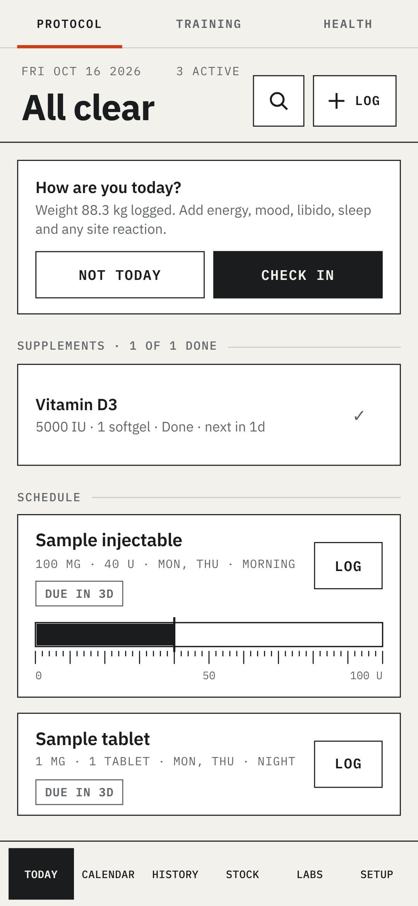
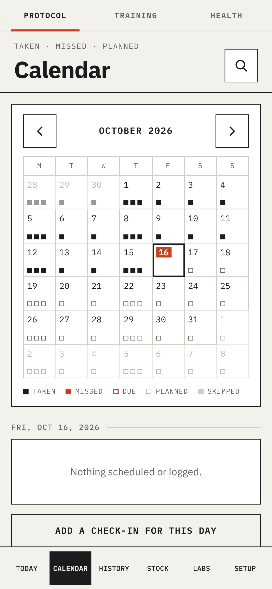
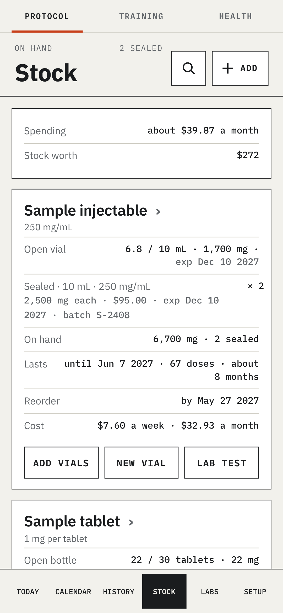
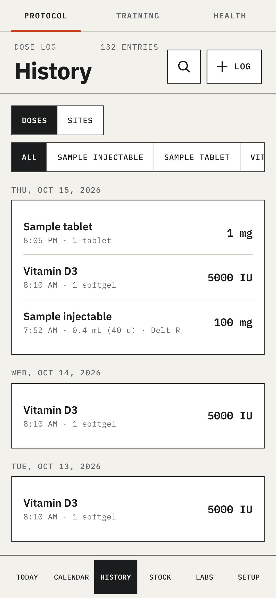

# Enhanced Training Studio · free edition

Version **1.0.7** · 16 Oct 2026

A free Android app for tracking your protocol: injections, orals and supplements. Everything stays on your phone.

   

- **Schedules and cycles:** every few days, set weekdays, or a cycle that stops after 6 or 12 weeks
- **Reminders:** morning and night, with Log and Snooze buttons on the notification
- **Logging:** the draw on the syringe, site rotation, vial stock and low-stock warnings
- **Estimated levels:** from your logged doses and each compound's half-life
- **Doctor report:** a PDF of your regimen, adherence, levels and injection log
- **Backups:** to your phone, or your own Google Drive, with an optional password; app lock

## Free edition and licence

This free edition is the injection tracker. A licence adds **training** (workouts, records, GPS runs), **blood tests** (PDF import, markers over time, on the levels chart) and **health** (Health Connect, readiness, live heart rate). It's a one-off payment, by card or bitcoin: https://enhancedtraining.app/pricing/

Both editions get every fix, including security fixes, at the same time.

## Install

Download `ETS-free-1.0.7.apk` from this repository's **Releases** page and open it on your phone. Android asks once to allow installs from your browser. It needs Android 9 or newer.

**Upgrading to a licence:** install the licensed app over the top. Your data stays.

**Check the download:** Android shows the signing certificate in the APK's details, and `apksigner verify --print-certs` prints it. The release APKs are signed with this certificate (SHA-256):

`39:08:81:B3:8E:D3:BB:21:96:E9:39:2C:73:ED:B9:90:26:5B:A6:A9:64:91:B1:8C:68:93:F6:3A:93:1A:F7:DB`

The release key was rotated from the app's original certificate: `25:F0:84:9E:72:6B:83:99:4D:D5:83:CA:85:BB:D1:68:05:1C:CC:D6:34:06:BB:50:9E:40:12:CE:25:A9:26:29`

## Get it with F-Droid

Add the app's F-Droid repository and updates arrive in F-Droid: open https://ets-public.github.io/ets-public/ on your phone and tap **Add to F-Droid**. It carries the full app, the same one as on https://enhancedtraining.app: everything in this free edition, plus training, blood tests and health, which unlock with a licence key. The licensed parts aren't open source, so that build isn't made from this code alone. It's signed with the same key as the APK on the Releases page, so it installs over it and keeps your data.

The F-Droid repository's fingerprint (SHA-256) is `C9E1C8FE40C99F38BBC72738E6E6ED4EBEDC0577095077176BC85F5E96543DB0`. F-Droid shows it when you add the repository: check that it matches.

## Build it yourself

You need Windows, Android Studio (for the Android SDK) and Node.js. Double-click `BUILD-APK.bat`. The script fetches a private copy of Node 22 and Java 21 if needed and builds `ETS-free-1.0.7.apk`. It's signed with your own Android debug key, so it installs as a separate copy, not as an update to the release APK.

## Licence

[Functional Source License 1.1, MIT Future License](LICENSE.md). You can use, change and share this code for your own use and for non-commercial teaching or research. You can't use it to offer a competing commercial product or service. Each version becomes available under the MIT licence two years after it was released.

The name "Enhanced Training Studio" and its logo aren't covered by the licence.
